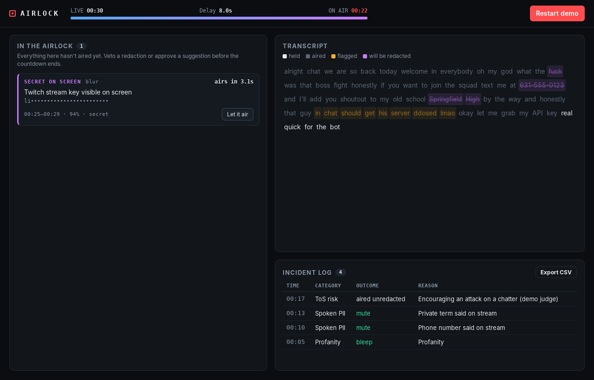

# Airlock

A broadcast delay with a brain. OBS streams into Airlock on your PC; Airlock holds the stream
for a few seconds, catches what shouldn't air, and redacts it before it reaches
Twitch/YouTube/Kick:

- **Swearing and slurs**: bleeped (token-based, leetspeak-aware wordlists)
- **Self-doxxing**: your address, phone, email, or private terms (real name, school, town) muted
- **Secrets on screen**: stream keys, API keys, tokens, private keys pixelated, retroactively
- **Context risks**: an LLM judge flags ToS-risk speech that has no bad words in it
- **You stay in control**: every flag shows a countdown; veto or approve before it airs. Dump button included.

Local-first: Whisper and Ollama on your GPU by default. Cloud providers are opt-in.

> Status: early. The engine (policy, decision engine, detectors, session) is implemented and
> tested; the desktop app runs a demo stream through it. Real ingest/egress, Whisper, the LLM
> judge and OCR are next. See [PLAN.md](PLAN.md).



## Quick start (dev)

Prereqs: Rust (stable), Node 22+, and the [Tauri prerequisites](https://tauri.app/start/prerequisites/) for your OS.

```bash
cargo test                        # engine tests
cd apps/desktop
npm install
npm run tauri dev                 # then click "Run demo"
```

## Docs

- [PLAN.md](PLAN.md): phased task list with checkboxes (agents update it as they go)
- [docs/ARCHITECTURE.md](docs/ARCHITECTURE.md): pipeline, crates, latency budget, core rules
- [AGENTS.md](AGENTS.md): conventions for AI coding agents
