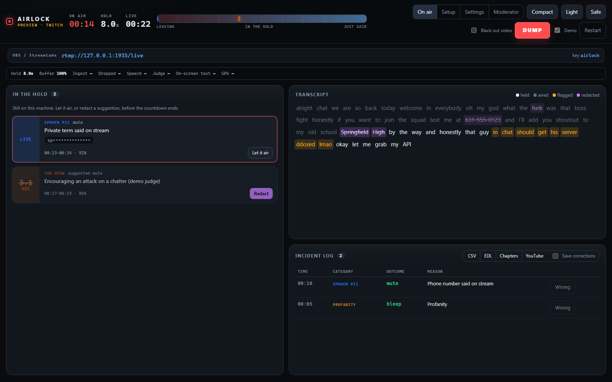
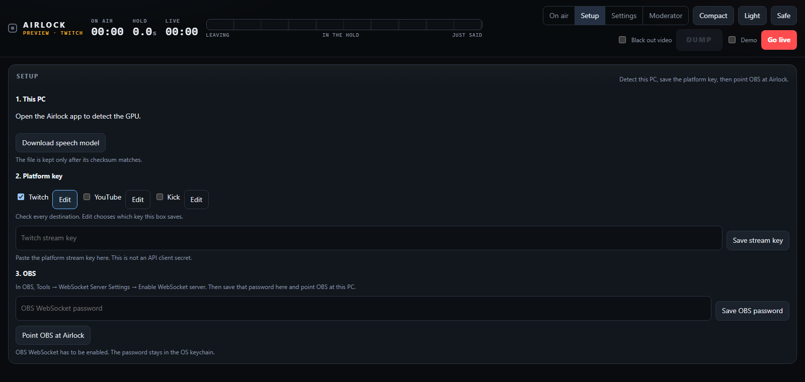
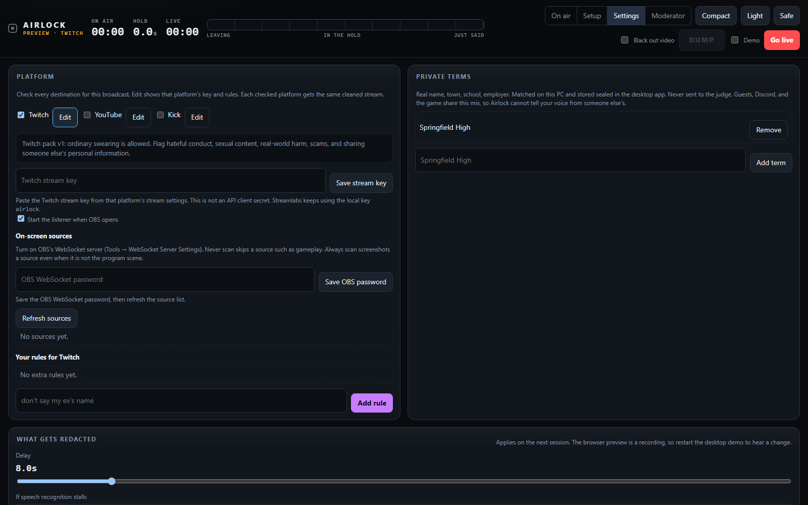

# Airlock

A free, open-source broadcast delay. OBS or Streamlabs Desktop sends the stream to Airlock on your PC. Airlock holds it for a few seconds, catches what should not air, and forwards the clean copy to Twitch, YouTube, or Kick.

There is no subscription and no license key. The judge, on-screen scanning, and a second destination are included. Speech and the judge run on your machine. Cloud speech and the cloud judge stay off until you turn them on, and those keys stay in the OS keychain.

The application is [MIT licensed](LICENSE). The OBS audio-delay plugin in `apps/obs-plugin` is GPL-2.0-or-later because it links OBS.

- **Swearing and slurs** are bleeped.
- **Spoken private information** (an address, phone number, or a term you listed) is muted.
- **Secrets on screen**, such as a stream key, are pixelated.
- **Context** with no bad word in it can still be flagged by the local judge.
- **You stay in control.** Each flag counts down. Veto it, let it air, or dump the hold.
- **Every destination you check** gets the same cleaned stream.

## On air

The hold, the marked transcript, and the incident log during the built-in demo.



## Setup

Point OBS at this PC, then save the platform key in the OS keychain. OBS keeps the local key `airlock`.



## Settings

Destinations, private terms, and the delay.



## Quick start

Prerequisites: Rust (stable), Node 22+, and the [Tauri prerequisites](https://tauri.app/start/prerequisites/) for your OS.

```bash
cargo test                        # engine tests
cd apps/desktop
npm install
npm run tauri dev                 # then click Demo, then Run demo
```

## Installers

Pushing a tag such as `v0.1.0`, or running the Release workflow by hand, builds a draft GitHub release:

- Windows: NSIS setup `.exe` and `.msi`
- macOS: Apple Silicon `.dmg`
- Linux: `.deb` and `.AppImage`

Those runner builds use CPU speech. They are not code-signed.

## Docs

- [PLAN.md](PLAN.md): phased task list
- [docs/ARCHITECTURE.md](docs/ARCHITECTURE.md): pipeline, crates, and core rules
- [docs/PRIVACY.md](docs/PRIVACY.md): what stays on this PC
- [AGENTS.md](AGENTS.md): conventions for coding agents
